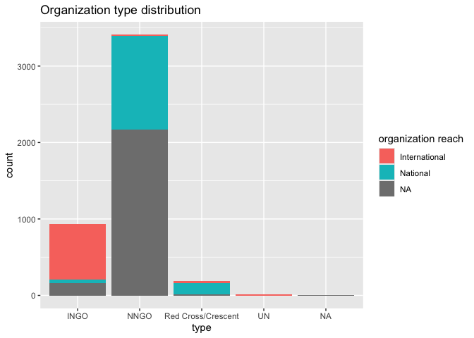
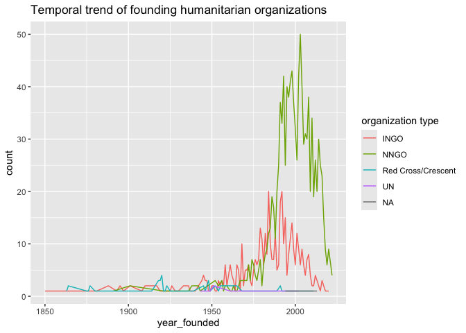

# gdho

The goal of `gdho` is to provide a detailed list of global humanitarian
organizations complied by [Humanitarian
Outcomes](https://www.humanitarianoutcomes.org/projects/gdho) which
contains basic information such as organization website and headquarter
location, as well as, operational information such as annual
expenditure. The original database is updated annually and this package
version uses data retrieved on September 20, 2023.

[](https://openwashdata.github.io/gdho/articles/examples.html)

## Installation

You can install the development version of gdho from
[GitHub](https://github.com/gdho) with:

``` r

# install.packages("devtools")
devtools::install_github("openwashdata/gdho")
```

Alternatively, you can download the individual datasets as CSV or XLSX
file from the table below.

| dataset | CSV | XLSX |
|:---|:---|:---|
| gdho_full | [Download CSV](https://github.com/openwashdata/gdho/raw/main/inst/extdata/gdho_full.csv) | [Download XLSX](https://github.com/openwashdata/gdho/raw/main/inst/extdata/gdho_full.xlsx) |
| gdho | [Download CSV](https://github.com/openwashdata/gdho/raw/main/inst/extdata/gdho.csv) | [Download XLSX](https://github.com/openwashdata/gdho/raw/main/inst/extdata/gdho.xlsx) |

## Data

The package provides access to 2 datasets `gdho` and `gdho_full`. They
are essentially the same data where the former is a concise version that
removes detailed country columns (200+ columns) about whether this
country has the humanitarian organization. Therefore here we only
describe the dataset `gdho`.

> All the organisations included the database have responded to
> humanitarian needs in at least one emergency context, individually or
> in partnership with other organisations, even if their stated mission
> is not strictly humanitarian. Not included are NGOs devoted to
> development, human rights, or political causes, or that do not work in
> emergency settings.

``` r

library(gdho)
```

The `gdho` data set has 33 variables and 4556 observations.

``` r

gdho |>
  head() |>
  gt::gt() |>
  gt::as_raw_html()
```

| id | year | name | abbreviated_name | type | international_or_national | website | hq_location | year_founded | year_closed | countries_of_operation_count | sector | religious_or_secular | religion | red_cross_code_of_conduct_signatory | chs_member | interaction_member | icva_member | staff | staff_imputed | natl | natl_imputed | intl | intl_imputed | percent_intl | ope_approx_usd | ope_imputed | ope/staff | ope_inflation_adjusted | ope_original_currency | humexp_approx_usd | humexp_imputed | humexp_inflation_adjusted |
|---:|---:|:---|:---|:--:|:--:|:---|:---|---:|---:|---:|:--:|:--:|:---|:--:|:--:|:--:|:--:|---:|:---|---:|:---|---:|:---|---:|---:|:---|---:|---:|:---|---:|:---|---:|
| 5420 | 2021 | Al Ta’alouf Charity | Al Ta’alouf | NNGO | NA | <https://www.altaalouf.org> | Syrian Arab Republic | NA | NA | 1 | NA | NA | NA | NA | NA | NA | NA | 890 | A | 890 | A | NA | NA | NA | 13386794 | A | 15041.34 | 14437416 | NA | 12850182 | A | 13858689 |
| 22 | 2020 | Action Africa Help-International | AAH-I | INGO | International | <http://www.actionafricahelp.org> | Kenya | 1987 | NA | 4 | NA | Secular | NA | NA | NA | NA | NA | NA | NA | NA | NA | NA | NA | NA | 14658708 | A | 17682.40 | 16578200 | NA | 12833628 | A | 14514134 |
| 23 | 2022 | Action Contre la Faim International (ACF/ACH/AAH) | ACF | INGO | International | <http://www.actioncontrelafaim.org> | France | 1979 | NA | 58 | NA | Secular | NA | 1 | 1 | 1 | 1 | 7912 | A | NA | NA | NA | NA | NA | 526 | A | 0.07 | 526 | Euro 463128000 | NA | NA | NA |
| 32 | 2022 | ActionAid International | NA | INGO | International | <http://www.actionaid.org> | South Africa | 1972 | NA | 45 | NA | Secular | NA | 1 | NA | NA | NA | 3249 | A | NA | NA | NA | NA | NA | 188 | A | 0.06 | 188 | Euro 165240000 | NA | NA | NA |
| 40 | 2021 | Adventist Development and Relief Agency | ADRA | INGO | International | <http://www.adra.org/> | United States | 1956 | NA | 74 | NA | Religious | Christian | 1 | NA | NA | NA | NA | NA | NA | NA | NA | NA | NA | 254598415 | A | 89647.33 | 274579794 | NA | 77966928 | A | 84085924 |
| 46 | 2021 | Afghanaid | A-Aid | INGO | International | <http://www.afghanaid.org.uk> | United Kingdom | 1983 | NA | 2 | NA | Secular | NA | 1 | NA | NA | NA | NA | NA | NA | NA | NA | NA | NA | 14357419 | A | 12627.46 | 15484217 | GBP 10480916 | NA | NA | NA |

For an overview of the variable names, see the following table.

``` R
#> Rows: 67 Columns: 5
#> ── Column specification ────────────────────────────────────────────────────────
#> Delimiter: ","
#> chr (5): directory, file_name, variable_name, variable_type, description
#> 
#> ℹ Use `spec()` to retrieve the full column specification for this data.
#> ℹ Specify the column types or set `show_col_types = FALSE` to quiet this message.
```

| variable_name | variable_type | description |
|:---|:---|:---|
| id | integer | A unique Id for each organisation |
| year | integer | Latest year information is available for |
| name | character | Full organisation name |
| abbreviated_name | character | Organisation abbreviation or acronym |
| type | integer | National NGO (NNGO), International NGO (INGO), UN, Red Cross/Crescent classification |
| international_or_national | integer | Organisation’s reach |
| website | character | Organisation page url |
| hq_location | character | Country where HQ office is located |
| year_founded | integer | Year of establishment |
| year_closed | integer | Year closed or last year of visible activity |
| countries_of_operation_count | integer | Number of countries operational in |
| sector | integer | Children/youth, coordination, disabilities, education, environment, food security/agriculture, health, landmines, livelihoods, logistics/communications, nutrition, refugees, shelter, veterinary, water/sanitation, women |
| religious_or_secular | integer | Organisations religious affiliation |
| religion | character | Specific religious affiliation (ex. Catholic, Islamic, Jewish) |
| red_cross_code_of_conduct_signatory | integer | Signatory status of the organisation |
| chs_member | integer | Signatory status to the Core Humanitarian Standard on Quality and Accountability  |
| interaction_member | integer | Membership status |
| icva_member | integer | Membership status |
| staff | integer | Actual number of total staff |
| staff_imputed | character | Imputed number of total staff |
| natl | integer | Actual number of national staff |
| natl_imputed | character | Imputed number of national staff |
| intl | integer | Actual number of international staff |
| intl_imputed | character | Imputed number of international staff |
| percent_intl | double | Percent of total staff that are international |
| ope_approx_usd | double | Actual approximate annual operational program expenditure in USD |
| ope_imputed | character | Imputed approximate annual operational program expenditure in USD |
| ope/staff | double | Percent of operational program expenditure per staff member |
| ope_inflation_adjusted | double | Operational program expenditure adjusted for inflation |
| ope_original_currency | character | Actual approximate operational program expenditure in original currency used by organisation |
| humexp_approx_usd | double | Approximate humanitarian expenditure in USD |
| humexp_imputed | character | Imputed approximate humanitarian expenditure in USD |
| humexp_inflation_adjusted | double | Approximate humanitarian expenditure adjusted for inflation |

## Example

The humanitarian organizations are categorized into 5 types: INGO
(International NGO), NNGO (National NGO), UN (United Nation), Red
Cross/Crescent, and NA (Not Available). Most of the organizations fall
into the NNGO type. For different types of organizations, how is their
organization reach distribute?

``` r

ggplot(data = gdho) +
  geom_bar(aes(x = type, fill=`international_or_national`)) +
  labs(title = "Organization type distribution", fill = "organization reach")
```



Throughout the years, how do different types of humanitarian
organizations increase?

``` r

count_by_year <- gdho |>
  filter(!is.na(year_founded)) |>
  group_by(year_founded, type) |>
  summarise(count = n())
#> `summarise()` has grouped output by 'year_founded'. You can override using the
#> `.groups` argument.
ggplot(data = count_by_year) +
  geom_line(aes(x = year_founded, y = count, color = type)) +
  labs(title = "Temporal trend of founding humanitarian organizations", color = "organization type")
```



# License

Data are available as
[CC-BY](https://github.com/openwashdata/gdho/blob/main/LICENSE.md).

# Citation

``` r

citation("gdho")
#> To cite package 'gdho' in publications use:
#> 
#>   Zhong M, Stoddard A, Mangono T (2024). "gdho: Global Database of
#>   Humanitarian Organizations." doi:10.5281/zenodo.10727977
#>   <https://doi.org/10.5281/zenodo.10727977>.
#> 
#> A BibTeX entry for LaTeX users is
#> 
#>   @Misc{zhong_etall:2024,
#>     title = {gdho: Global Database of Humanitarian Organizations},
#>     author = {Mian Zhong and Abby Stoddard and Tichakunda Mangono},
#>     year = {2024},
#>     doi = {10.5281/zenodo.10727977},
#>     abstract = {A dataset of global humanitarian organizations collected by Humanitarian Outcomes.},
#>     version = {0.0.2},
#>   }
```

## Related References

\[1\] [GDHO project
description](https://www.humanitarianoutcomes.org/projects/gdho)
